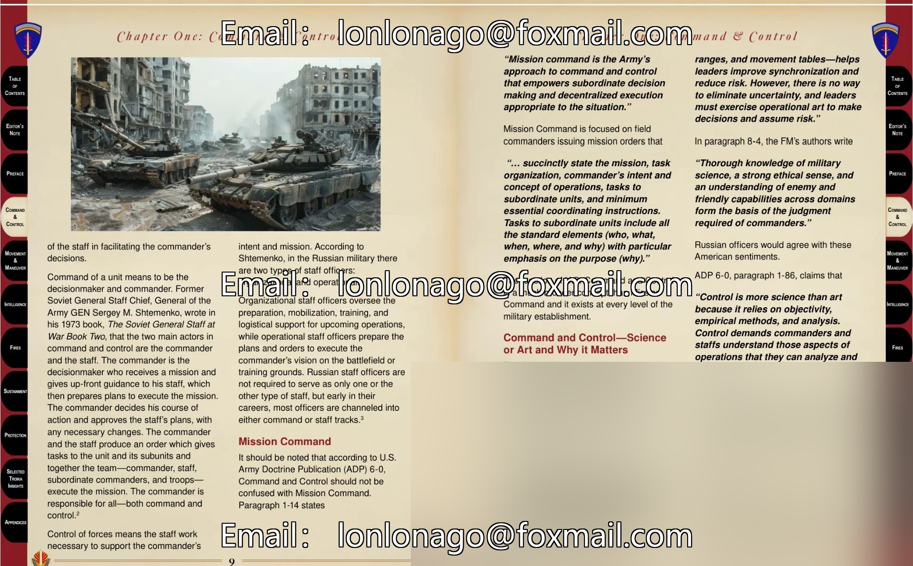
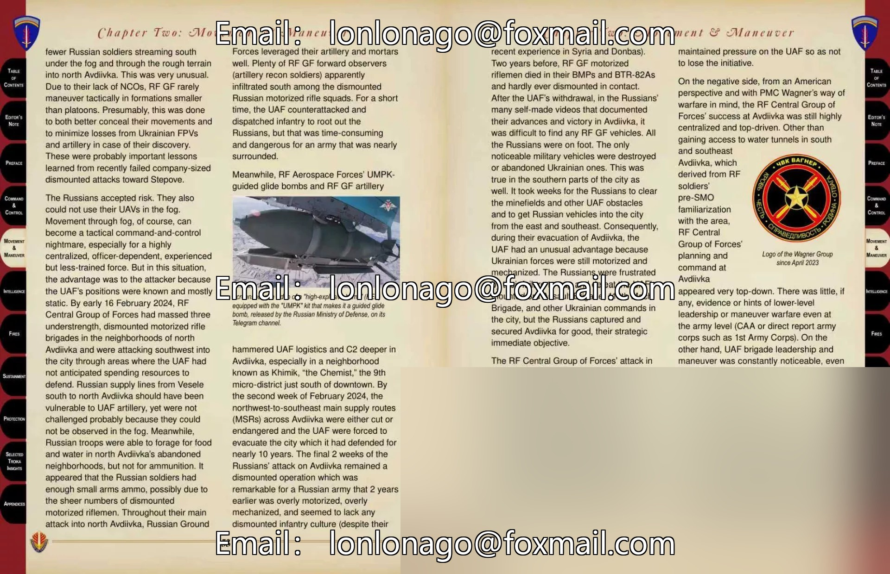
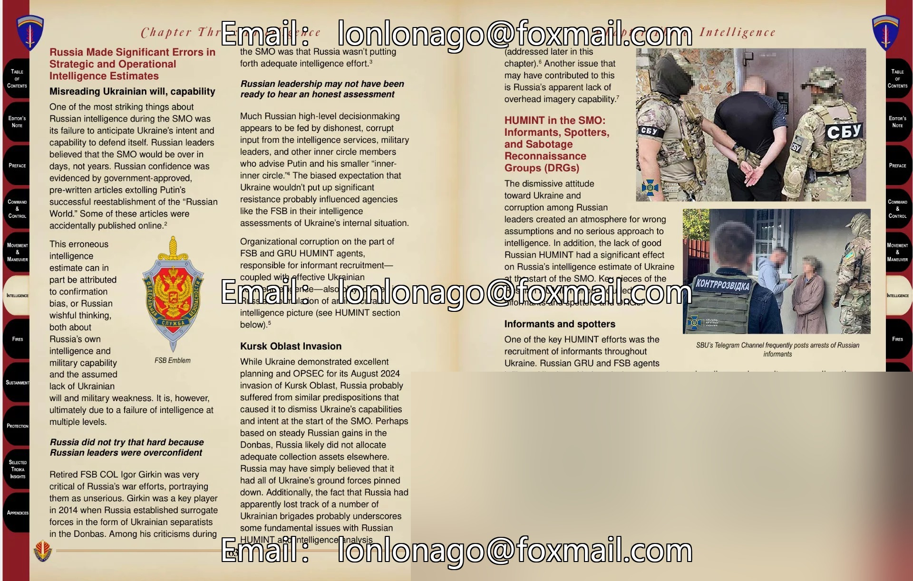
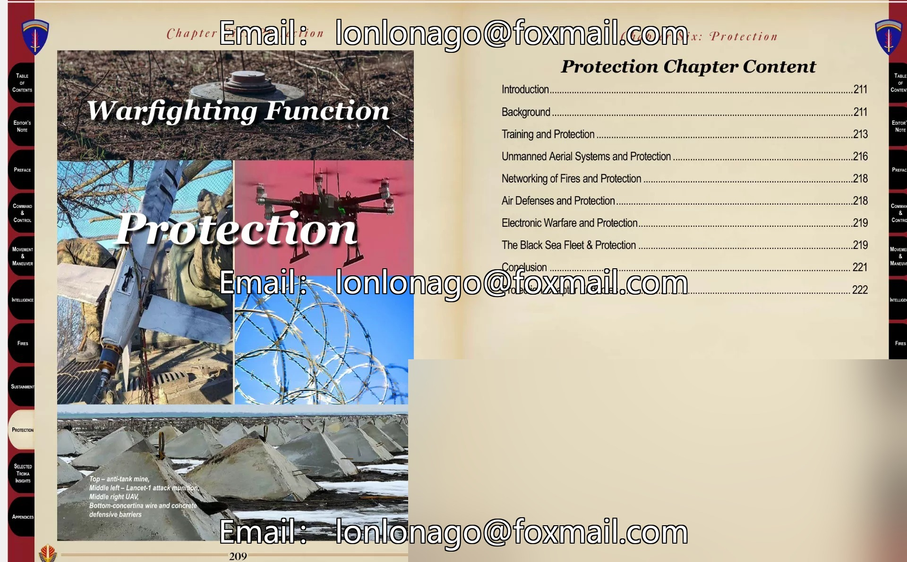

# Observation compilation on special military actions in Russia

## Body

Observation compilation on the special military actions of Russia
Written by the U.S. Army European and African Command as a military analysis report, comprehensively analyzing the special military actions of Russia.
1. Core content classification
1. Command & Control
In-depth exploration of Russia's command system and combat command process, comparing the concept of American Military Mission Command.
2. Movement & Maneuver
Analysis of Russia's tactical use, from strategic intent to specific actions, demonstrating Russia's mobility capabilities on the battlefield.
3. Intelligence
Evaluation of Russia's intelligence collection and analysis capabilities, revealing intelligence errors in the Ukraine-Russia conflict.

4. Fire
Research the Russian military's fire usage strategy, including multi-dimensional fire systems such as artillery, air defense, and electronic warfare.
5. Sustainment
Analyze the Russian military's logistics support system, covering supplies and maintenance, demonstrating its battlefield survival capability.
6. Protection
Explore the Russian military's protection measures, including air defense, electronic warfare, and decoys, multi-level protection methods.
II. Publication Information
First published in February 2024, updated to the latest version in March 2025.
The entire book has 325 pages, including a large number of charts and real-world case analyses.
are reproducible, and upon sale, they cannot be returned.

This compilation covers Russia's special military operation across categories such as command and control, movement and maneuver, intelligence, fires, sustainment and protection, with publication details, page count, edition and chart case studies.

<!-- AI_ENRICHED -->

## Images

## Payment

Here is a pay link on Stripe ( https://buy.stripe.com/3cs8yP7sY87d0vu9AB ). Please contact me lonlonago@foxmail.com after funding $89, and I will send you a complete data files , thank you!

